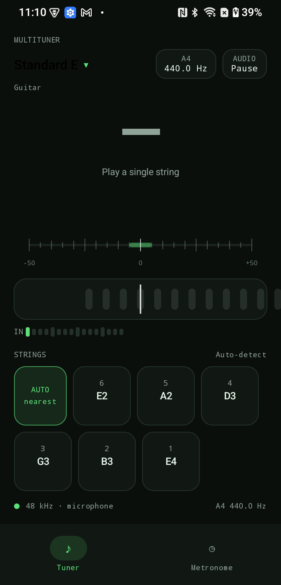
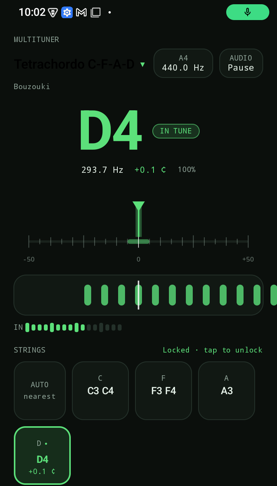
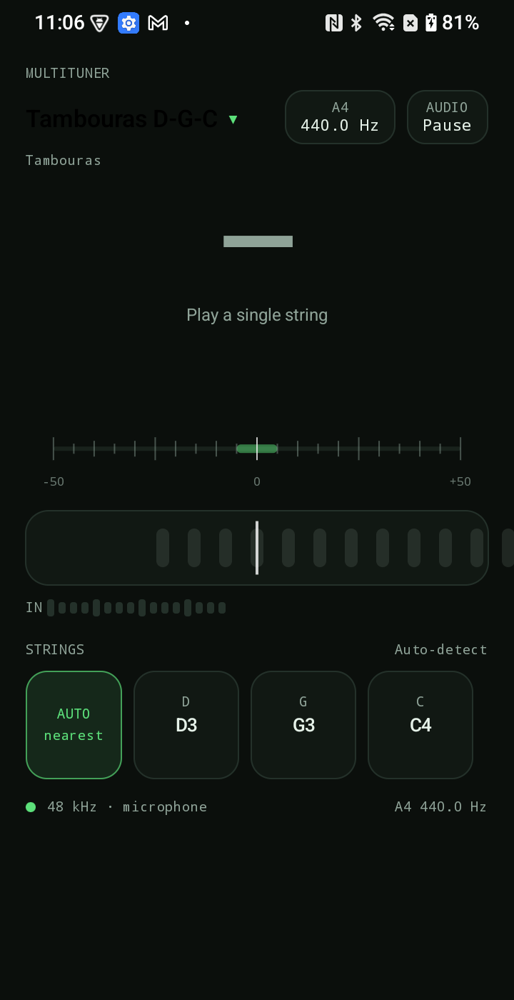
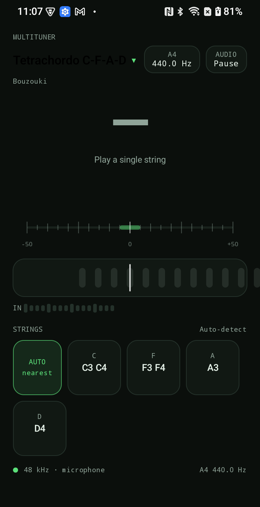
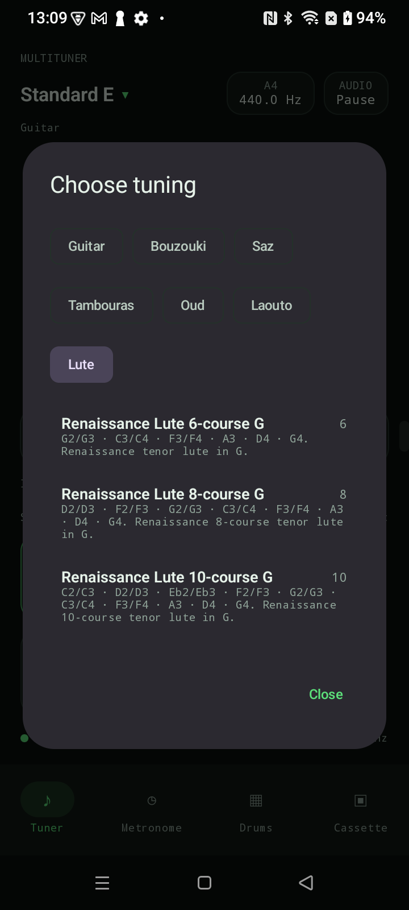
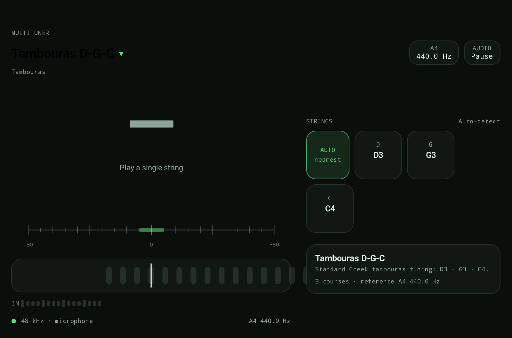

# MultiTuner

[](https://github.com/tkleisas/MultiTuner/actions/workflows/android.yml)
[](LICENSE)
[](https://github.com/tkleisas/MultiTuner/releases)

MultiTuner is a fast, offline Android tuner for stringed instruments. It is built
around a native C++ YIN pitch detector and provides real-time note, cents, needle,
strobe and per-course feedback.

The app ships with presets for guitar, Greek bouzouki (3- and 4-course), saz and
tambouras. It targets Android 10 and newer and is designed for both phones and
tablets.

## Screenshots

<p align="center">
  
  
  
  
</p>

<p align="center">
  
  
</p>

From left to right: guitar Standard E, bouzouki D4 in tune, tambouras D-G-C and
bouzouki C-F-A-D. Bottom: the tuning picker and the tablet layout.

## Features

- **Native pitch detection** - C++ YIN detector running through NDK/JNI, with a
  4096-sample analysis window, DC blocking, silence gating and parabolic
  interpolation.
- **String-aware feedback** - the detected pitch is mapped to the nearest string
  or course in the selected tuning. The matching course is highlighted with its
  live cents offset.
- **Auto and manual modes** - detect the nearest course automatically, or tap a
  course chip to lock the tuner to that course.
- **Multiple visualisations** - large note name, cents readout, confidence,
  needle gauge, animated strobe band, input level meter and an `IN TUNE` state.
- **Reference pitch** - adjustable A4 reference from 415 Hz to 466 Hz.
- **Instrument presets** - guitar, bouzouki, saz and tambouras.
- **Profile persistence** - the selected tuning, course lock and reference pitch
  are restored on the next launch.
- **Phone and tablet layouts** - portrait, landscape and wide-screen layouts.
- **Offline and private** - no internet permission; audio is processed on-device
  and is never recorded or uploaded.
- **Debug test tone** - debug builds include a `TONE` button for testing the
  complete audio path without an instrument. It is not present in release builds.
- **16 KB page sizes** - the 64-bit native libraries are built with 16 KB
  alignment for Android 15+ devices and Google Play compliance.

## Supported tunings

| Instrument | Presets |
|---|---|
| Guitar | Standard E, Drop D, Eb Standard, D Standard, Drop C, C Standard, DADGAD, Open G, Open D, Open E, Baritone B, 7-String Standard |
| Bouzouki | Tetrachordo C-F-A-D, Tetrachordo D-G-B-E, Trichordo D-A-D, Trichordo D-G-D |
| Saz | Bozuk (Kara) low A, Bozuk (Kara) high A, Bağlama low A, Bağlama high A |
| Tambouras | **D-G-C (default)**, D-A-D, D-A |

Course notes are shown low to high unless the tuning is intentionally
re-entrant. The bouzouki C-F-A-D preset includes the octave pairs on the C and F
courses.

Saz tuning names and octaves vary by instrument size and region. Both low-A and
high-A variants are included for Bozuk and Bağlama; use the one that matches your
instrument.

New presets can be added in
[`TuningLibrary.kt`](app/src/main/java/com/tkleisas/multituner/model/TuningLibrary.kt).

## How it works

1. `AudioRecord` captures mono audio at 48 kHz (44.1 kHz fallback), preferring an
   unprocessed input source when the device supports it.
2. Samples are passed to a native ring buffer. Every 2048 new samples a
   4096-sample window is analysed with YIN.
3. The detector returns frequency, confidence and RMS level. A one-pole DC
   blocker and a silence gate suppress rumble and empty input.
4. Kotlin maps the frequency to the closest string in the active tuning,
   calculates cents, smooths the display and applies an in-tune hold.
5. Jetpack Compose renders the note, needle, strobe, level meter and course
   chips.

Detection is monophonic: play one string at a time. Polyphonic "strum all
strings" detection is not implemented.

## Requirements

- Android 10 (API 29) or newer
- Target Android 16 (API 36), as required by Google Play for new apps
- JDK 17 or newer (CI uses Temurin 17)
- Android SDK 36
- Android NDK `27.2.12479018`
- CMake `3.22.1`
- Gradle wrapper `8.11.1` (downloaded automatically)

The app builds for `arm64-v8a`, `armeabi-v7a` and `x86_64`. The 64-bit
libraries are linked with 16 KB page-size alignment.

## Build

### Android Studio

1. Open the project in Android Studio.
2. Let Android Studio create `local.properties` with `sdk.dir` pointing to your
   Android SDK, or create it manually:
   ```properties
   sdk.dir=/path/to/Android/Sdk
   ```
3. Install SDK 36, NDK `27.2.12479018` and CMake `3.22.1` when prompted.
4. Sync Gradle and run the `app` configuration.

### Command line

```bash
export ANDROID_HOME="$HOME/Android/Sdk"
export JAVA_HOME="/path/to/jdk-17"

yes | sdkmanager --licenses
sdkmanager "platforms;android-36" "build-tools;35.0.0" \
  "ndk;27.2.12479018" "cmake;3.22.1"

./gradlew assembleDebug
```

The debug APK is written to:

```
app/build/outputs/apk/debug/app-debug.apk
```

Run the JVM tests, lint, native detector tests and the 16 KB page-size check:

```bash
./gradlew testDebugUnitTest
./gradlew lintDebug
./native-tests/run.sh

./gradlew assembleRelease bundleRelease
./scripts/check_16kb_page_size.sh \
  app/build/outputs/apk/release/app-release.apk \
  app/build/outputs/bundle/release/app-release.aab
```

### 16 KB page sizes

Android 15+ devices can use 16 KB memory pages, and Google Play requires apps
targeting Android 15+ to support them. The NDK build sets
`-Wl,-z,max-page-size=16384` for `arm64-v8a` and `x86_64`; the CI release job
verifies both the APK and AAB before publishing.

### Release optimization

Release builds use:

- `isMinifyEnabled = true`
- `isShrinkResources = true`
- `android.enableR8.fullMode=true`

The R8 mapping file is written to
`app/build/outputs/mapping/release/mapping.txt`, and the AAB embeds it for Play
Console deobfuscation. JNI entry points are kept in
[`app/proguard-rules.pro`](app/proguard-rules.pro).

## Testing

The test suite has fast JVM tests for pure Kotlin logic and host-side native
tests for the YIN detector.

```bash
./gradlew testDebugUnitTest
./native-tests/run.sh
./gradlew lintDebug
```

Run all of them with:

```bash
./scripts/test.sh
```

The JVM tests cover:

- frequency, MIDI and cents conversions at multiple reference pitches
- sharp/flat note naming and octave numbering
- tuning preset integrity and the expected guitar/bouzouki/saz/tambouras notes
- string matching, locked courses, octave-pair courses and chromatic fallback
- display smoothing, in-tune hold, confidence/RMS gating and reset behavior

The native tests cover YIN accuracy for guitar, bouzouki, saz and low B,
including harmonic and plucked-style signals, detuned input and silence gating.

For TDD: write a failing test first, make the smallest change that passes it,
then run `./scripts/test.sh` before committing.

## Release signing

Release builds are signed when either `keystore.properties` (local development)
or the `RELEASE_*` environment variables (CI) are present.

### Local keystore

Create a release keystore outside the repository:

```bash
mkdir -p ~/.android/keystores
keytool -genkeypair -v -storetype PKCS12 \
  -keystore ~/.android/keystores/multituner-release.p12 \
  -alias multituner \
  -keyalg RSA -keysize 4096 -validity 10000
```

Then create `keystore.properties` in the project root:

```properties
storeFile=/home/you/.android/keystores/multituner-release.p12
storePassword=your-store-password
keyAlias=multituner
keyPassword=your-key-password
```

`keystore.properties` and all `*.p12`, `*.jks` and `*.keystore` files are
gitignored. Never commit them.

Build and verify the signed APK and Play Store bundle:

```bash
./gradlew assembleRelease bundleRelease

"$ANDROID_HOME/build-tools/35.0.0/apksigner" verify \
  --print-certs app/build/outputs/apk/release/app-release.apk

"$JAVA_HOME/bin/jarsigner" -verify \
  app/build/outputs/bundle/release/app-release.aab
```

Outputs:

```
app/build/outputs/apk/release/app-release.apk
app/build/outputs/bundle/release/app-release.aab
```

> **Back up the keystore and its passwords.** If you distribute updates outside
> Google Play, losing the signing key means you cannot publish an update for the
> same application ID. With Play App Signing, the upload key can be reset, but
> the original app-signing key still matters.

### GitHub Actions signing

The workflow expects these repository secrets:

| Secret | Value |
|---|---|
| `RELEASE_KEYSTORE_BASE64` | Base64-encoded release keystore |
| `RELEASE_KEYSTORE_PASSWORD` | Keystore password |
| `RELEASE_KEY_ALIAS` | Key alias, e.g. `multituner` |
| `RELEASE_KEY_PASSWORD` | Key password |

Set them with the GitHub CLI:

```bash
base64 -w0 ~/.android/keystores/multituner-release.p12 > keystore.b64
gh secret set RELEASE_KEYSTORE_BASE64 < keystore.b64
gh secret set RELEASE_KEYSTORE_PASSWORD
gh secret set RELEASE_KEY_ALIAS
gh secret set RELEASE_KEY_PASSWORD
rm keystore.b64
```

On macOS, create the base64 value with:

```bash
base64 -i ~/.android/keystores/multituner-release.p12 | tr -d '\n' > keystore.b64
```

The workflow writes the decoded keystore to a temporary runner directory and
passes the path and credentials to Gradle through `RELEASE_KEYSTORE_PATH`,
`RELEASE_KEYSTORE_PASSWORD`, `RELEASE_KEY_ALIAS` and `RELEASE_KEY_PASSWORD`.
Nothing is written back to the repository.

## CI/CD

The workflow is defined in
[`.github/workflows/android.yml`](.github/workflows/android.yml).

- Pushes to `master`/`main` and pull requests run the native detector tests,
  JVM unit tests, Android lint and `assembleDebug`, then upload the debug APK
  as a workflow artifact.
- Pushes of tags matching `v*` additionally decode the release keystore, build
  a signed APK and AAB, verify both, and publish them as GitHub release assets
  named `MultiTuner-vX.Y.Z.apk` and `MultiTuner-vX.Y.Z.aab`.
- The workflow uses Ubuntu 24.04, Temurin JDK 17, Android SDK 36, NDK
  `27.2.12479018` and CMake `3.22.1`.
- Tag builds publish both `MultiTuner-vX.Y.Z.apk` and
  `MultiTuner-vX.Y.Z.aab`. The AAB is the upload artifact for Google Play.
- Tag builds verify 16 KB page-size alignment for the 64-bit native libraries
  before uploading the release assets.

### Creating a release

1. Update `versionCode` and `versionName` in `app/build.gradle.kts`.
2. Commit the change.
3. Create and push an annotated tag:

   ```bash
   git tag -a v0.0.8 -m "MultiTuner v0.0.8"
   git push origin v0.0.8
   ```

4. Watch the `Android CI` run in GitHub Actions. The signed APK and AAB appear
   on the corresponding GitHub release.

## Publishing to Google Play

The current release targets Android 16 (API 36), which Google Play requires for
new apps. The Play Store upload artifact is the signed AAB:

```
app/build/outputs/bundle/release/app-release.aab
```

Play Store preparation material is in [`store/`](store):

- [`store/listing.md`](store/listing.md) - store listing copy, declarations and
  reviewer instructions
- [`store/icon-512.png`](store/icon-512.png) - app icon
- [`store/feature-graphic-1024x500.png`](store/feature-graphic-1024x500.png) -
  feature graphic
- [`store/screenshots/`](store/screenshots) - phone and tablet screenshots
- [`docs/privacy-policy.html`](docs/privacy-policy.html) - privacy policy
  published at
  <https://tkleisas.github.io/MultiTuner/privacy-policy.html>

### Play Console setup

1. Create or sign in to a Google Play Developer account and create a new app
   with the package name `com.tkleisas.multituner`.
2. Complete the store listing using `store/listing.md` and upload the icon,
   feature graphic and screenshots.
3. Complete **App content**: privacy policy, ads, app access, content rating,
   target audience and Data safety.
4. Upload the signed AAB to **Internal testing** first and test the Play-signed
   build on a physical device.
5. If this is a personal developer account created after November 13, 2023,
   run a closed test with at least **12 testers opted in for 14 consecutive
   days** before applying for production access.
6. Run the pre-launch report, fix any issues, then apply for production access
   and roll out.

### Play App Signing

New apps must use Play App Signing. The recommended setup is:

- Let Google generate and manage the **app signing key**.
- Register the existing `multituner` keystore as the **upload key**.

Export the upload certificate for Play Console:

```bash
keytool -export -rfc \
  -keystore ~/.android/keystores/multituner-release.p12 \
  -alias multituner \
  -file ~/.android/keystores/multituner-upload-cert.pem
```

Upload that `.pem` under **Release > Setup > App signing**.

The Play Store build is re-signed by Google. GitHub release APKs are signed with
the upload key, so a sideloaded APK cannot be upgraded in place by the Play
Store version. Uninstall the sideloaded app before installing from Play.

## Project structure

```
.
├── app/
│   ├── src/main/java/com/tkleisas/multituner/
│   │   ├── MainActivity.kt
│   │   ├── TunerViewModel.kt
│   │   ├── audio/          # AudioRecord capture, JNI bridge, test tone
│   │   ├── model/          # Tuning model, presets, string matching
│   │   ├── tuner/          # Pure pitch display engine
│   │   └── ui/             # Compose screen, gauges, theme
│   ├── src/main/cpp/       # YIN detector and JNI entry point
│   ├── src/test/           # JVM unit tests
│   └── build.gradle.kts
├── docs/                   # GitHub Pages landing page, privacy policy, screenshots
├── store/                  # Play Store listing copy and graphics
├── native-tests/           # Host-side DSP tests
├── scripts/                # Release verification (16 KB page sizes)
├── .github/workflows/
└── LICENSE
```

## Adding a tuning

Add a `Tuning` entry to
[`TuningLibrary.kt`](app/src/main/java/com/tkleisas/multituner/model/TuningLibrary.kt).
Each course contains one or more `TuningString(midi, centsOffset)` entries.
`centsOffset` is available for future microtonal or per-string offsets.

For octave-paired courses, provide both MIDI notes. For example, the bouzouki
C course is:

```kotlin
course("C", 48, 60)
```

## Debug test tone

Debug builds show a `TONE` button in the status line. It plays the currently
locked course, or the nearest detected course, through the speaker so the full
microphone-to-detector path can be tested without an instrument. The button and
tone generator are excluded from release builds.

## Privacy

MultiTuner does not request the `INTERNET` permission. Microphone audio is
processed on-device in real time and is not stored, recorded or transmitted.
The hosted privacy policy is at
<https://tkleisas.github.io/MultiTuner/privacy-policy.html>.

## Roadmap

- Custom tuning editor with saved user tunings
- Microtonal/makam per-string offsets and alternate temperaments
- More instruments and regional presets
- Optional polyphonic string detection

## Contributing

Issues and pull requests are welcome. Before opening a pull request, run:

```bash
./scripts/test.sh
```

Do not commit keystores, passwords or other signing material.

## License

MultiTuner is released under the MIT License. See [LICENSE](LICENSE).

The native YIN detector is adapted from the tuner effect in the YAWN DAW
(MIT License, Copyright (c) 2026 Tasos Kleisas), with a corrected parabolic
interpolation stage and additional silence gating and fallback handling.

## Acknowledgments

- YAWN DAW for the original YIN tuner reference
- AndroidX, Jetpack Compose and the Android NDK toolchain
- The Greek and Turkish musicians whose instruments shaped the preset list
